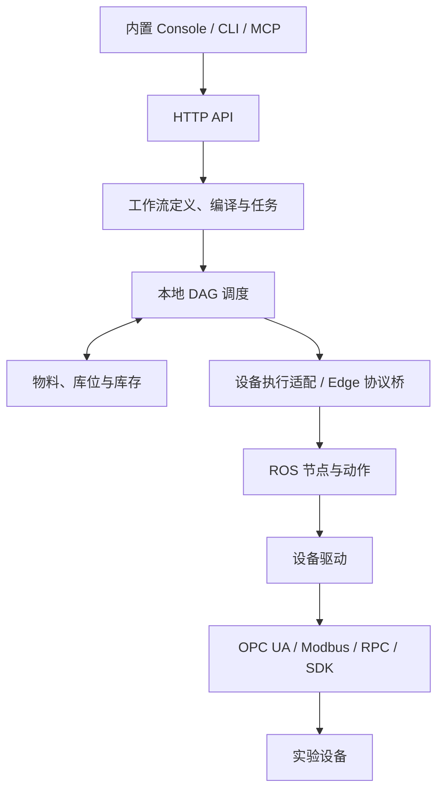

# Uni-Lab-OS 模块功能与目录索引

整理日期：2026-09-10。依据本地工作区源码，基准提交为 `d0aa7ff2`，包含整理时已有的未提交修改。本文件是代码导航，不代表每项能力都经过运行验收。

下列路径以 `Uni-Lab-OS/` 仓库根目录为基准；同一目录中可以包含多个逻辑模块。相邻仓库单独列在末尾。

**整体结构**

Uni-Lab-OS 包含操作界面、工作流与物料业务、执行调度、设备运行、包管理和工作区进程管理。核心执行关系如下：

Workspace Host 管理本地组件的进程生命周期；Registry 与 Package Manager 为上述各层提供类型、动作合同、资源模板和领域包。

**主模块总表**

| 模块 | 主要功能 | 对应目录 / 关键入口 |
| --- | --- | --- |
| 启动与应用装配 | `unilab` 命令入口；读取配置、设备图和包，选择进程角色，装配 API、调度与设备运行环境，处理退出和重启。 | [unilabos/app/](../unilabos/app/)，入口 [main.py](../unilabos/app/main.py)；`runtime_topology.py`、`control_plane.py`、`runtime_capabilities.py` |
| Web/API 服务 | FastAPI 路由、健康与就绪状态、OpenAPI、设备目录、静态控制台；工作流与物料 API 分别委托所属业务模块。 | [unilabos/app/web/](../unilabos/app/web/)；`server.py`、`api.py`、`device_catalog.py`、`console.py`；同级 `workflow_api.py`、`workspace_authoring_api.py` |
| 内置运营控制台 | 总监控、物料、试剂、实验操作、工作流、任务；展示 DAG、任务矩阵、运行输入、资源占用和异常处置。 | [frontend/src/](../frontend/src/)；`pages/`、`components/`、`hooks/`、`lib/edgeClient.ts` |
| 工作流定义与创作 | Python DSL、AST 解析、源码与图转换、导入、校验、修订应用、领域包工作流发现及源码监控。 | [unilabos/workflow/](../unilabos/workflow/)；`authoring.py`、`authoring_engine.py`、`source_discovery.py`、`catalog.py`、`service.py` |
| 实验操作与组合工作流 | 实验操作分类、不可变发布合同、已发布操作的组合调用、静态展开、合同兼容性检查和父工作流刷新。 | [unilabos/workflow/](../unilabos/workflow/)；`operation_category.py`、`publication_catalog.py`、`composite_expansion.py`、`composite_contract_refresh.py` |
| 工作流任务运行 | 执行前预检，冻结一次任务的图和执行计划，维护 Task/Job、事件、结果、人工确认、异常干预与重试，并接入调度器；设备运行进程重启后终止原任务并清理软件执行占用。 | [unilabos/workflow/](../unilabos/workflow/)；`execution_plan.py`、`run_preflight.py`、`task_scheduler_bridge.py`、`store.py`、`intervention.py` |
| 本地调度 | 收集 DAG 就绪节点，按优先级和等待老化排序，检查依赖及资源占用，解析参数、派发动作，处理完成回报与任务控制。 | [unilabos/app/scheduler/](../unilabos/app/scheduler/)；`service.py`、`dag_state.py`、`ordering.py`、`dispatch.py`、`backend.py`、`resource_lock.py` |
| 物料、库位与库存 | 物料实例、Site 占用、批次、试剂和容器内容；数量预留、扣减与释放，派发准入、转运及分装结算，持久台账和查询 API。 | [unilabos/app/scheduler/inventory/](../unilabos/app/scheduler/inventory/)；`service.py`、`store.py`、`station_resource.py`、`dispatch_admission.py`、`reagent_api.py` |
| Edge 协议与会话 | 连接本地 Scheduler 和设备运行进程，注册设备会话，下发作业，回传状态、反馈、结果及异常；保存通信与执行记录。 | [unilabos/app/edge_control/](../unilabos/app/edge_control/)；`client.py`、`http.py`、`local_authority.py`、`local_edge_session.py`、`store.py` |
| 设备与动作注册表 | 从 YAML、装饰器与 AST 扫描发现设备/资源类型；生成动作参数、返回值、资源占用等合同，投影为设备目录和工作流节点模板。 | [unilabos/registry/](../unilabos/registry/)；`registry.py`、`decorators.py`、`ast_registry_scanner.py`、`action_template_projection.py`；`devices/`、`resources/`、`device_comms/` |
| 设备驱动 | 各类仪器及工作站的实际控制逻辑、设备状态和动作实现；支持内置驱动与外部领域包。 | [unilabos/devices/](../unilabos/devices/)；如 `liquid_handling/`、`arm/`、`agv/`、`balance/`、`hplc/`、`pump_and_valve/`、`workstation/` |
| 工业通信适配 | 处理 OPC UA、Modbus、RPC 等连接及读写，供驱动复用。部分厂商 SDK 和专有通信仍位于具体驱动中。 | [unilabos/device_comms/](../unilabos/device_comms/)；`opcua_client/`、`modbus_plc/`、`rpc.py`、`universal_driver.py` |
| ROS 设备运行层 | 将驱动包装为 ROS 节点，初始化设备，提供 Topic、Service、Action 通信及 Host/Slave 运行，转换消息。 | [unilabos/ros/](../unilabos/ros/)；`device_node_wrapper.py`、`initialize_device.py`、`main_slave_run.py`、`executor.py`、`nodes/`、`msgs/` |
| 资源模型与设备拓扑 | 设备/物料资源树、稳定身份、父子结构、位置与尺寸；读取 JSON/GraphML 图，完成 UniLab 与 PyLabRobot 资源转换。 | [unilabos/resources/](../unilabos/resources/)；`resource_tracker.py`、`graphio.py`、`instance_identity.py`、`site_definition.py`、`container.py` |
| 实验协议动作生成 | 将加液、离心、过滤、加热冷却、搅拌、泵送等实验协议，结合设备拓扑展开成底层动作序列。 | [unilabos/compile/](../unilabos/compile/)；`add_protocol.py`、`centrifuge_protocol.py`、`heatchill_protocol.py`、`pump_protocol.py`、`utils/` |
| Python 协议数据模型 | 定义实验协议的 Pydantic 参数模型，例如加液、转运、加热和搅拌。 | [unilabos/messages/](../unilabos/messages/)；主要实现在 `__init__.py` |
| ROS 接口定义 | 定义 ROS 消息、服务与动作的数据格式，用于构建 `unilabos_msgs`。 | [unilabos_msgs/](../unilabos_msgs/)；`msg/`、`srv/`、`action/`、`CMakeLists.txt` |
| 包管理 | 领域包静态编译、依赖分发、工作区包更新和驱动激活；提供 `unilab package ...`。 | [unilabos/package_manager/](../unilabos/package_manager/)；四个子模块见下表 |
| Workspace Host | 每个工作区的进程管理入口；管理 Backend、Edge、PLC 等组件，生成启动计划，检查就绪状态，处理重启、日志、操作记录与状态恢复。 | [unilabos/workspace_host/](../unilabos/workspace_host/)；`host.py`、`launch.py`、`discovery.py`、`scheduler_lifecycle.py`、`cli.py` |
| 受管 Runtime Supervisor | 向桌面端暴露窄 HTTP 接口，管理受管 Worker 和模拟器子进程，提供状态、启停和日志。 | [unilabos/managed_runtime/](../unilabos/managed_runtime/)；`supervisor.py`，命令 `unilab-supervisor` |
| HostLink 组网 | Host/Slave 间的 TCP NDJSON 请求通道；握手、心跳、物料查询、ROS 组网参数下发与网络诊断。 | [unilabos/hostlink/](../unilabos/hostlink/)；`server.py`、`client.py`、`protocol.py`、`ros_assist.py`、`doctor.py` |
| Python SDK 与 CLI | 通过统一客户端读取工作流、运行和观察任务、获取物料场景与布局；CLI 负责参数解析及输出。 | [unilabos/client/](../unilabos/client/)、[unilabos/app/cli/](../unilabos/app/cli/)；`domain.py`、`session.py`、`material_layout.py`；工作区 CLI 在 `workspace_host/cli.py` |
| Agent / MCP 接口 | 将工作区状态、组件管理、任务操作、物料场景/布局等 SDK 能力封装为 MCP 工具。 | [unilabos/agent_tools/](../unilabos/agent_tools/)；`workflow.py`，命令 `unilab-mcp` |
| 配置与基础设施 | 配置类与环境变量覆盖、动态导入、日志、文件保留策略、进程输出、异常与可选 OpenTelemetry 追踪。 | [unilabos/config/](../unilabos/config/)、[unilabos/utils/](../unilabos/utils/)；`config.py`、`import_manager.py`、`log.py`、`log_storage.py`、`tracing.py` |
| 设备和物料可视化资产 | 模型、机器人描述、RViz 配置及资源可视化辅助代码。 | [unilabos/device_mesh/](../unilabos/device_mesh/)；`devices/`、`resources/`、`resource_visalization.py`、`view_robot.rviz` |

**包管理的四个子模块**

| 子模块 | 职责 | 目录 |
| --- | --- | --- |
| Package Catalog | 解析项目元数据，静态编译设备、动作、工作流与物料资产，形成可验证目录；发现和检查阶段不执行包作者代码。 | [package_catalog/](../unilabos/package_manager/package_catalog/) |
| Package Distribution | 包构建与归档、安装、依赖解析和锁文件、目录/云端分发适配。 | [package_distribution/](../unilabos/package_manager/package_distribution/) |
| Workspace Runtime | 监听工作区包变化，维护候选代，验证并激活目录，处理创作源码挂载与需要重启的变更。 | [workspace_runtime/](../unilabos/package_manager/workspace_runtime/) |
| Driver Runtime | 根据已编译目录进行驱动运行时激活；包含 Python 激活适配与运行合同。 | [driver_runtime/](../unilabos/package_manager/driver_runtime/) |

`workspace_runtime` 管理的是包及其编译代；`workspace_host` 管理的是工作区进程。两者名称相近，职责不同。四层依赖规则见 [Package Manager README](../unilabos/package_manager/README.md)。

**内置设备驱动的目录分组**

下表中的子目录均位于 [unilabos/devices/](../unilabos/devices/)。这是按用途整理的导航，具体型号能力应继续查看各驱动。

| 用途 | 子目录 |
| --- | --- |
| 移液与物料处理 | `liquid_handling/`、`pump_and_valve/`、`powder_dispense/`、`resource_container/` |
| 机器人与运动 | `arm/`、`agv/`、`gripper/`、`motor/`、`cnc/`、`ros_dev/` |
| 分析检测 | `balance/`、`hplc/`、`zhida_hplc/`、`zhida_gcms/`、`Qone_nmr/`、`xrd_d7mate/`、`opsky_Raman/`、`raman_uv/`、`UV_test/`、`platereader/` |
| 温控与实验辅助 | `temperature/`、`heaterstirrer/`、`rotavap/`、`separator/`、`sealer/`、`xpeel/`、`cytomat/` |
| 工作站与专项设备 | `workstation/`、`battery/`、`neware_battery_test_system/`、`cameraSII/` |
| 虚拟设备与示例 | `virtual/` |

`vaccum/` 当前仅有初始化文件，不能据目录名视为完整真空设备实现。`device_mesh/` 中的 mesh 表示三维网格模型，与设备组网无关。

**内置控制台页面**

| 页面 | 主要用途 | 文件 |
| --- | --- | --- |
| 总监控 | 实验室状态、活动任务和异常概况。 | [OverviewPage.tsx](../frontend/src/pages/OverviewPage.tsx) |
| 物料 | 物料层级、位置、库位占用、任务资源绑定及在途动作。 | [LiveMaterialsPage.tsx](../frontend/src/pages/LiveMaterialsPage.tsx) |
| 试剂 | 试剂信息、库存和容器内容。 | [ReagentsPage.tsx](../frontend/src/pages/ReagentsPage.tsx) |
| 实验操作 | 实验操作目录、分类及复用入口。 | [OperationsPage.tsx](../frontend/src/pages/OperationsPage.tsx) |
| 工作流 | 工作流定义、图、参数、修订与发布相关操作。 | [WorkflowsPage.tsx](../frontend/src/pages/WorkflowsPage.tsx) |
| 任务 | 创建和跟踪执行、任务矩阵、节点详情与运行控制。 | [TasksPage.tsx](../frontend/src/pages/TasksPage.tsx) |

六个页面以 [routes.ts](../frontend/src/lib/routes.ts) 和 [App.tsx](../frontend/src/App.tsx) 为准；实际可见性、写权限、未发布运行和单步调试由 Runtime 能力字段控制。能力投影由 [runtime_capabilities.py](../unilabos/app/runtime_capabilities.py) 提供。

控制台构建输出到 [unilabos/app/web/static/console/](../unilabos/app/web/static/console/)，由 OS 在 `/console/` 提供服务。修改页面应从 `frontend/src/` 开始。

**测试、示例与交付目录**

| 目录 | 用途 |
| --- | --- |
| [tests/](../tests/) | 自动化测试，按 workflow、scheduler_core、resources、registry、package_manager、workspace_host 等功能划分。`scheduler_core` 是测试分组，生产代码主要在 `workflow/` 和 `app/scheduler/`。 |
| [unilabos/test/](../unilabos/test/) | 示例实验图、实验配置、测试设备及命令材料，与顶层测试套件用途不同。 |
| [examples/](../examples/) | 工作流导入、手工确认与组合工作流等使用示例。 |
| [scripts/](../scripts/) | 安装、开发环境、打包辅助与验证脚本。 |
| [recipes/](../recipes/) | Conda 与 ROS 消息包等构建配方。 |
| [deploy/](../deploy/) | 容器镜像、Kubernetes 和产品手册部署配置。 |
| [docs/](./) | 用户指南、开发说明、产品手册及验证记录；`product_manual/source/` 是手册内容的重要入口。 |
| [plan/](../plan/) | 设计与实施计划；用于了解背景，不能单凭计划认定能力已实现。 |
| [diagrams/](../diagrams/) | 架构和流程图材料。 |
| [.github/](../.github/) | 持续集成与仓库自动化配置。 |

**阅读时要区分的几个概念**

1. **进程角色与控制面。** 当前 [runtime_topology.py](../unilabos/app/runtime_topology.py) 只允许 `local` 控制面，支持 `combined`、`workspace_backend`、`edge_runtime` 三种进程角色。拆分模式下，本地 `workspace_backend` 承担 API、工作流、库存和调度，`edge_runtime` 承担设备执行；`workspace_backend` 这个名字不表示远程业务后端。
2. **当前代码与历史云端适配。** `app/ws_client.py`、`app/web/client.py` 和部分 Backend 适配代码仍在仓库中，但当前启动逻辑拒绝旧云端 `websocket` bridge，且不挂接旧 HTTP 云端桥。可用的本地跨进程 `edge_control` 仍使用 HTTP/WebSocket；不能据此说所有 WebSocket 都已移除。见 [main.py](../unilabos/app/main.py) 与 [control_plane.py](../unilabos/app/control_plane.py)。
3. **工作流定义与执行。** Workflow 是可复用定义；本地目录从领域包 Python 源码重建，发布合同保存于领域包的 `workflow_publications/<workflow_uuid>/`。WorkflowTask 是一次冻结执行，其 Task/Job、结果和执行事实持久化在运行库；定义刷新不等于改写已创建任务。
4. **两种编译。** `workflow/` 处理工作流源码、图、执行计划和调度规格；`compile/` 处理具体实验协议到底层动作的展开。
5. **资源树与库存。** `resources/` 负责资源结构、拓扑和 PLR 互转；`app/scheduler/inventory/` 负责可操作的物料、库位占用、数量和台账事实。物料父子结构、库位占用和执行锁是不同关系。
6. **本地调度的实际实现。** 当前使用 [ordering.py](../unilabos/app/scheduler/ordering.py) 的 `StableLocalOrderer`，由 [integration.py](../unilabos/app/scheduler/integration.py) 装配；不能沿用旧注释，将其描述为调用独立 `uni-lab-scheduler` 服务。
7. **设备后端支持程度。** [app/backend.py](../unilabos/app/backend.py) 的 ROS 分支有实际启动实现；`simple`、`automancer` 分支仍为占位。README 或参数中出现名称不代表对应运行路径完整可用。

**按修改目标定位代码**

| 要做的事情 | 优先查看 |
| --- | --- |
| 新接入一台仪器或工作站 | 对应领域包的 `devices/`；OS 内参考 `unilabos/devices/`、`registry/decorators.py` 和 `device_comms/`。 |
| 增加动作参数、返回值或资源需求 | `registry/` 中的动作合同、注解和模板投影，以及设备驱动方法。 |
| 修改工作流编辑、Python 导入或发布 | `workflow/authoring*`、`source_*`、`publication_catalog.py`，以及 `app/workflow_api.py`。 |
| 修改并行运行、动作顺序或资源等待 | `app/scheduler/`，以及 `workflow/execution_*`、`resource_lock_plan.py`、`task_scheduler_bridge.py`。 |
| 修改物料占用、预留、转运或分装 | `app/scheduler/inventory/`，以及 `workflow/material_transfer_settlement.py`、`material_aliquot_settlement.py`；只读资源占用投影在 `workflow/resource_usage.py`。 |
| 修改任务状态、结果或异常处理 | `workflow/service.py`、`store.py`、`intervention.py`、`error_handling.py`、`error_control.py`、`execution_restart_recovery.py`；对外路由在 `app/`。 |
| 修改启动、组件重启或就绪检查 | `workspace_host/` 与 `app/main.py`、`runtime_topology.py`。 |
| 修改领域包安装或源码更新行为 | `package_manager/` 中对应的四个子模块。 |
| 修改业务页面 | `frontend/src/pages/`、`components/` 与 `lib/edgeClient.ts`。 |
| 修改 CLI / AI 工具 | `app/cli/`、`client/`、`agent_tools/`；进程操作通过 `workspace_host/`。 |

**同一工作区的相关项目**

以下是 `Uni-Lab-OS/` 的相邻目录，不是其 Python 子模块。

| 项目 | 功能与关系 | 主要目录 |
| --- | --- | --- |
| [Uni-Lab-SZLab](../../Uni-Lab-SZLab/) | SZLab 聚合物工作站的领域设备包，提供具体设备、物料与实验流程，由 OS 加载和执行。 | `szlab_poly_studio/devices/`、`szlab_poly_studio/resources/`、`szlab_poly_studio/workflows/`、`szlab_poly_studio/common/`、`deployment/` |
| [unilab_robot_template](../../unilab_robot_template/) | 机械臂、导轨及组合工作单元的共享合同、型号能力、通信适配和运行时装配。 | `packages/unilab-robot-contracts/`、`packages/unilab-arm-cr5/`、`packages/unilab-arm-cr7/`、`packages/unilab-rail-linear/`、`packages/unilab-robot-runtime/` |
| [PLC-Sim](../../PLC-Sim/) | 工业协议仿真与联调工具；包含 OPC UA/PLC 动作和传感器仿真，以及 Modbus 服务与寄存器仿真。 | `PLC-Sim/`、`Modbus-Sim/`、`deploy/` |

控制台入口可核对 [OS Vite 配置](../frontend/vite.config.ts) 和 [产品接口说明](product_manual/source/interfaces.md)。
